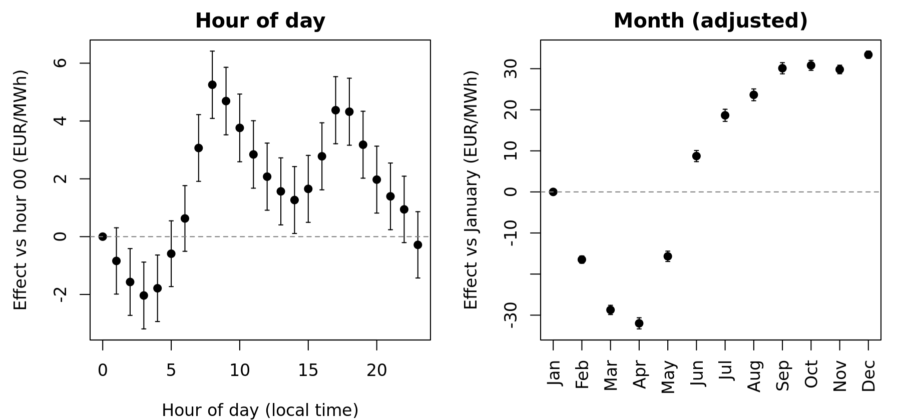

# What Drives the Hourly Electricity Price in NO1?

A statistical model of **hourly day-ahead electricity prices in the Norwegian bidding zone NO1** (Oslo / south-east Norway), using 50,855 hours of Nord Pool data from 2016 to early 2022 together with NVE hydro reservoir levels.

**Question:** How much of the variation in the hourly NO1 price is explained by time of day, season, weekday, year, consumption and reservoir fill level, and which of these matter most?

📄 **Report:** [`report/STAT201_Project_report.pdf`](report/STAT201_Project_report.pdf) · 🎤 **Slides:** [`presentation/slides.pdf`](presentation/slides.pdf)

<p align="center">
  
</p>

*Estimated hour-of-day and month effects with 95 % confidence intervals. The morning and evening peaks and the spring snow-melt dip are clearly visible.*

## Key findings

| | |
|---|---|
| **Model fit** | Gaussian GLM (identity link) explains **R² = 0.667** |
| **Most important predictors** | Year ≫ month > reservoir level > hour > weekday > consumption |
| **Hydro effect** | **+10 percentage points** of reservoir filling is associated with a price **≈ 7.1 EUR/MWh lower**. The effect stays robust with HAC standard errors |
| **Demand effect** | Consumption has the expected sign but adds little once calendar effects are known, and is **not significant** with autocorrelation-robust SEs |
| **Diagnostics** | Strong residual autocorrelation (lag-1 ρ = 0.961, Durbin–Watson 0.078), heteroscedasticity and a heavy upper tail, so naive standard errors are far too optimistic |
| **Non-linearity** | A GAM with smooth terms improves AIC by **5,222** but leaves the main conclusions unchanged |

The year factor captures most of the variation (the 2021 energy crisis). It stands in for drivers outside the dataset, such as continental gas and carbon prices and interconnector flows. The model is therefore descriptive rather than causal, and the report says so explicitly.

## Methods

* **Data preparation** (`R/project.R`, sections 1–4)
  * Hourly UTC time axis checked for gaps and duplicates. Calendar factors are built in local time (Europe/Oslo) so that daylight-saving changes are handled correctly.
  * The raw Nord Pool download is cross-checked against the merged dataset. **2,562 forward-filled prices** were identified and removed instead of being treated as real observations.
  * The weekly NVE reservoir level is aligned to ISO weeks.
* **Modelling:** Gaussian GLM with hour, month, weekday and year as factors plus consumption and reservoir level. Includes term-wise deviance analysis (`drop1`), nested model comparison and multicollinearity checks (VIF, auxiliary regressions).
* **Inference under autocorrelation:** ACF analysis, Durbin–Watson test and **Newey–West (HAC)** standard errors via `sandwich`/`lmtest`.
* **Robustness:** a GAM (`mgcv`) with smooth effects for consumption and reservoir level.
* **Reproducibility:** every number in the report and slides is written by the script to `tables/numbers.tex` and pulled into LaTeX as a macro, so there are no hand-copied numbers.

## Repository structure

```
R/project.R              full pipeline: cleaning -> GLM -> diagnostics -> HAC -> GAM -> tables/figures
data/processed/          no1_clean.csv (analysis dataset written by the script)
data/raw/                raw inputs (not tracked, see below)
figures/                 all figures used in the report
tables/                  LaTeX tables, model output, numbers.tex, session info
report/                  report.tex + compiled PDF
presentation/            Beamer slides
references.bib
```

## Reproducing

Requires R ≥ 4.3 with `data.table`, `hdf5r`, `car`, `lmtest`, `sandwich` and `mgcv`.

```bash
Rscript R/project.R                       # regenerates figures/ and tables/
cd report && latexmk -pdf report.tex      # rebuilds the report
```

The script reads two raw files in `data/raw/`: `dataset_timeseries.csv` (a merged Nordic hourly dataset built for my master's thesis) and the raw Nord Pool download `nordpool_2016-01-01_2022-11-30.h5`. Together they are about 100 MB, so they are not tracked in git. The cleaned analysis dataset `data/processed/no1_clean.csv` is included and is enough to refit the models.

**Data sources:** Nord Pool day-ahead prices and consumption, and NVE weekly reservoir statistics.

---
*Project in STAT201, University of Bergen (autumn 2026).*
